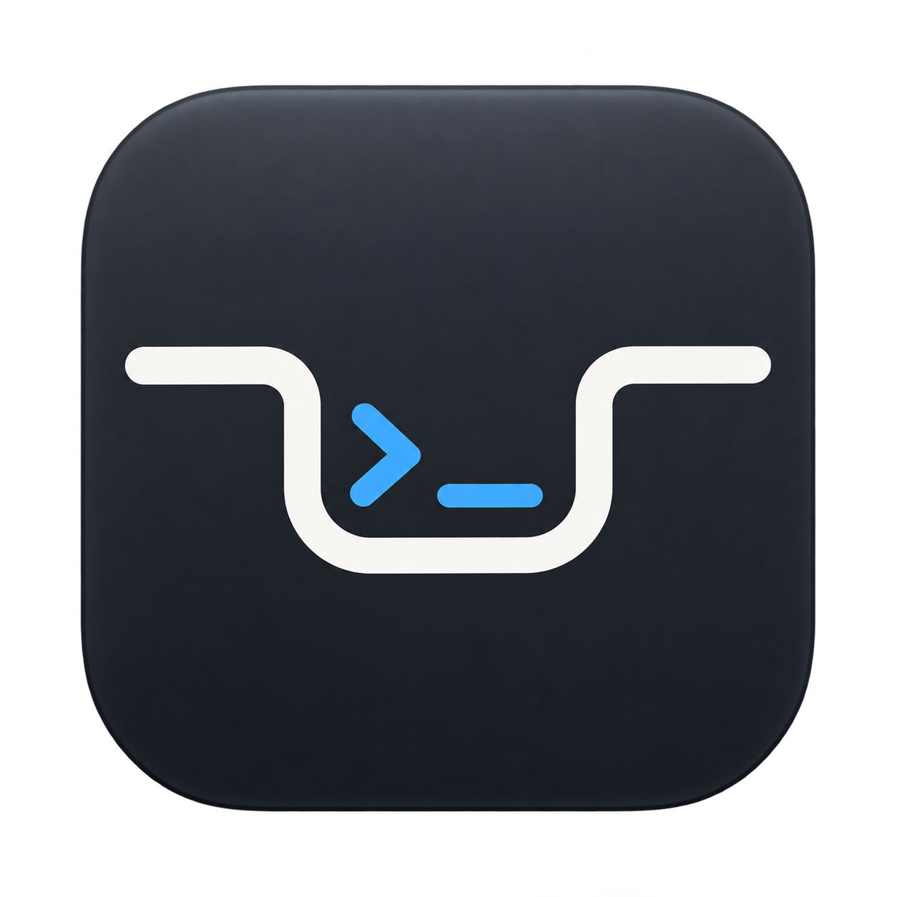
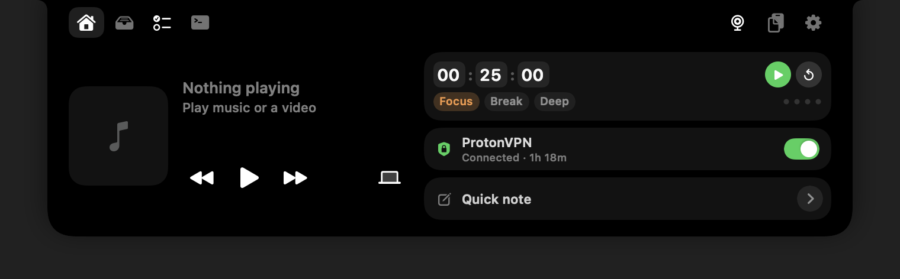
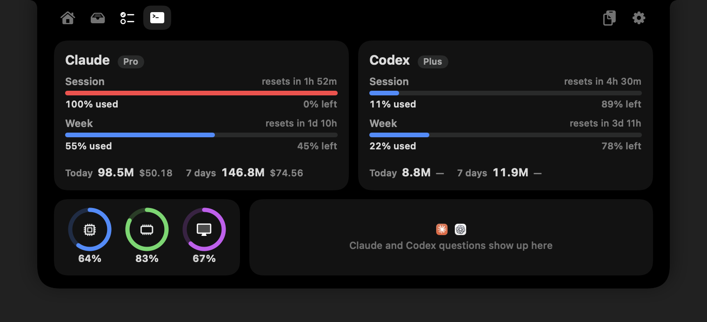
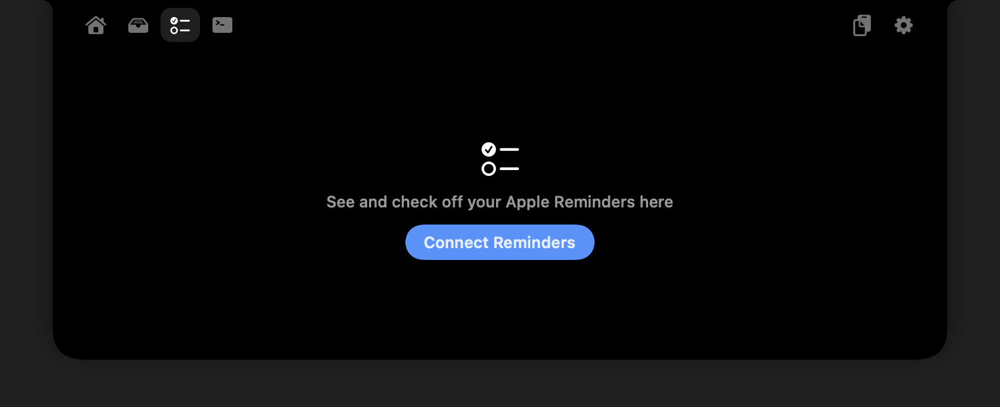
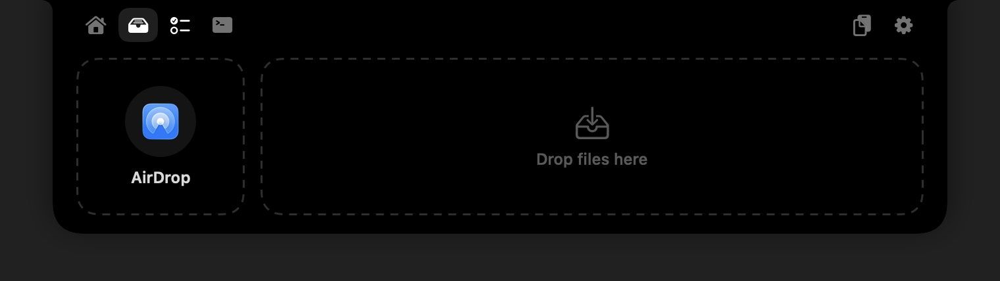

<p align="center"></p>

# NotchLab

A native macOS app that turns your notch into a small workspace. Hover over it to open your tools, then move away to close it. Works on displays without a notch, too.

## Features

- Claude and Codex usage tracking, agent status, questions, and approval requests.
- CPU, memory, and GPU monitoring.
- Music controls, audio output switching, and focus timers.
- Quick notes, clipboard history, and Apple Reminders.
- A file shelf with AirDrop, VPN controls, and an optional camera mirror.

## Screenshots









## Install

Requires an **Apple silicon Mac**, **macOS 14 or later**, and **Xcode Command Line Tools with Swift 6 or later**.

Install the command line tools if needed:

```sh
xcode-select --install
```

Then build and install:

```sh
git clone https://github.com/HamzaLovesCoding/NotchLab.git
cd NotchLab
./build.sh --install
```

The script installs and opens `/Applications/NotchApp.app`. Hover over the notch to get started. You can enable **Launch at Login** from the settings menu.

Allow Camera and Reminders access when using those features. Controlling some VPN apps also requires Accessibility access.

## Agent questions and approvals

NotchLab shows Claude Code and Codex permission requests in the notch with **Allow** and **Deny**, lets you answer Claude's multiple-choice questions there, and flashes a side alert when an agent finishes. Building the app doesn't install hooks; add the bundled `notch-hook` helper to each tool yourself. If your config already has a `hooks` section, merge these entries into it.

**Claude Code:** `~/.claude/settings.json`

```json
{
  "hooks": {
    "PermissionRequest": [{ "matcher": "*", "hooks": [{ "type": "command", "command": "/Applications/NotchApp.app/Contents/MacOS/notch-hook claude", "timeout": 300 }] }],
    "PreToolUse": [{ "matcher": "AskUserQuestion", "hooks": [{ "type": "command", "command": "/Applications/NotchApp.app/Contents/MacOS/notch-hook claude", "timeout": 300 }] }],
    "Stop": [{ "hooks": [{ "type": "command", "command": "/Applications/NotchApp.app/Contents/MacOS/notch-hook claude" }] }],
    "UserPromptSubmit": [{ "hooks": [{ "type": "command", "command": "/Applications/NotchApp.app/Contents/MacOS/notch-hook claude" }] }],
    "SessionEnd": [{ "hooks": [{ "type": "command", "command": "/Applications/NotchApp.app/Contents/MacOS/notch-hook claude" }] }]
  }
}
```

**Codex:** `~/.codex/hooks.json`, then run `/hooks` in Codex once to trust it.

```json
{
  "hooks": {
    "PermissionRequest": [{ "matcher": "*", "hooks": [{ "type": "command", "command": "/Applications/NotchApp.app/Contents/MacOS/notch-hook codex", "timeout": 300 }] }],
    "Stop": [{ "hooks": [{ "type": "command", "command": "/Applications/NotchApp.app/Contents/MacOS/notch-hook codex" }] }],
    "UserPromptSubmit": [{ "hooks": [{ "type": "command", "command": "/Applications/NotchApp.app/Contents/MacOS/notch-hook codex" }] }],
    "SessionEnd": [{ "hooks": [{ "type": "command", "command": "/Applications/NotchApp.app/Contents/MacOS/notch-hook codex" }] }]
  }
}
```

While a request waits in the notch, the agent holds its terminal prompt. Answer in the notch, click **Terminal** to answer there instead, or wait about five minutes for the terminal prompt to come back. If NotchLab isn't running, the hook exits immediately and the agents behave as usual. Codex questions aren't supported yet, only its approvals and finished alerts.
